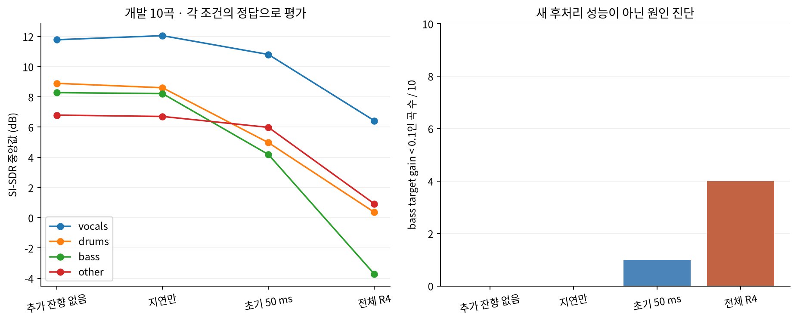

# 지연과 초기 반사와 전체 잔향의 분리 영향

개발 10곡의 새 HTDemucs 추론 60개를 실행했다. 원본 및 전체 RIR 출력은 기존 결과를 재사용했다. 이 실험은 잔향 성분을 바꾸어 만든 입력의 진단이며, 관측된 혼합에 적용한 후처리의 성능 개선 실험이 아니다.

## 확인된 결론

지연만 적용한 bass의 원본 대비 변화는 +0.020 dB로 작았다. R4 초기 50 ms는 지연만 대비 −4.326 dB, 전체 R4는 초기 R4 대비 −6.399 dB였다. 전체 R4 gain을 유지한 초기 구간 대조에서도 전체 R4가 −8.131 dB 낮았다. 따라서 이 개발 10곡에서는 지연만이 주된 원인이라는 설명은 지지되지 않고, 초기 반사와 후기 부분 모두 영향을 보였다.

초기 R4의 bass 소실은 1/10, 전체 R4는 4/10이었다. 하지만 초기/전체 입력과 정답 자체가 다르므로 이를 실제 후처리로 소실을 4→1로 줄였다고 설명해서는 안 된다. 초기 RIR 절단은 주파수 응답과 에너지 배분도 바꾸며, R2/R3의 bass 후기 차이 신뢰구간은 0을 포함했다. 모든 공간에 대한 확정 결론이 아니다.

Notion 상세 결과: https://app.notion.com/p/414457fc721b81b4acf3ce2d2ed8fdf8

## 실험 조건

- D0: 추가 RIR 없음.
- D1: 음원별 기하학적 도달 지연만 반영한 단위 임펄스. 각 stem RMS를 원본에 맞춤.
- E1~E4: 실제 생성 RIR의 직접 도달 뒤 50 ms까지 유지, 다음 5 ms cosine fade. 각 stem RMS를 원본에 맞춤.
- F1~F4: 전체 RIR. 기존 데이터와 같은 정답·분리 결과.
- E4-fixedgain: E4에 전체 R4 데이터 생성 gain을 적용. 초기 성분의 크기를 다시 조정하는 영향 확인용.
- 동일 중앙 30초·44.1 kHz stereo·HTDemucs 955717e8·FP32·shifts0·segment7s·overlap0.25. 새 학습 없음.
- 50 ms는 이번 탐색의 고정값이다. 모든 공간에 공통인 물리적 초기/후기 경계라고 가정하지 않는다.

## 절대 성능과 베이스 소실

| 조건 | vocals | drums | bass | other | bass 소실 / 10 |
|---|---:|---:|---:|---:|---:|
| original | 11.785 | 8.898 | 8.283 | 6.795 | 0 |
| delay | 12.053 | 8.607 | 8.219 | 6.705 | 0 |
| early_R1 | 10.885 | 8.321 | 6.715 | 5.712 | 1 |
| full_R1 | 10.344 | 8.660 | 7.369 | 5.622 | 1 |
| early_R2 | 10.691 | 5.194 | 4.795 | 6.041 | 1 |
| full_R2 | 7.646 | 3.977 | -0.111 | 3.955 | 2 |
| early_R3 | 10.755 | 5.046 | 4.434 | 6.009 | 1 |
| full_R3 | 6.704 | 2.746 | -1.886 | 2.917 | 3 |
| early_R4 | 10.808 | 4.973 | 4.188 | 5.984 | 1 |
| full_R4 | 6.424 | 0.366 | -3.724 | 0.924 | 4 |
| early_R4_fixedgain | 8.157 | 5.687 | 5.476 | 5.842 | 1 |

단위 dB, 각 조건의 절대 중앙값. vocals는 무음 정답 1곡을 제외해 9곡, 나머지는 10곡이다. 중앙값끼리 뺀 값과 다음 대응 차이 중앙값은 다를 수 있다.

## 같은 곡의 대응 차이

| 비교 | vocals | drums | bass | other | bass 95% CI |
|---|---:|---:|---:|---:|---|
| delay minus original | 0.144 | -0.070 | 0.020 | 0.065 | [-0.203, 0.167] |
| early_R4 minus delay | -0.795 | -3.688 | -4.326 | -1.606 | [-9.055, -2.891] |
| full_R1 minus early_R1 | -0.213 | 0.072 | -0.070 | -0.129 | [-0.156, 0.490] |
| full_R2 minus early_R2 | -2.440 | -2.295 | -3.203 | -1.954 | [-6.563, 1.304] |
| full_R3 minus early_R3 | -3.154 | -3.495 | -4.658 | -2.501 | [-9.467, 0.667] |
| full_R4 minus early_R4 | -3.618 | -4.933 | -6.399 | -3.990 | [-13.913, -0.365] |
| full_R4 minus early_R4_fixedgain | -1.334 | -4.282 | -8.131 | -4.215 | [-15.839, -4.825] |

CI는 곡을 10,000회 재표집한 탐색적 percentile bootstrap(seed 20261110)이다. 작은 개발 세트에서 여러 비교를 본 결과이며 확증적 일반화 성능으로 주장하지 않는다.

## 해석 범위

지연만 적용한 결과, 초기 반사까지 남긴 결과, 전체 잔향 결과를 구분한다. 전체 RIR의 후기 부분을 제거하면 주파수 응답과 에너지 배분도 변하므로 시간 감쇠 길이 하나의 독립 효과로 해석하지 않는다. 초기 50 ms 조건과 fixedgain 조건을 함께 사용해 RMS 복원에 따른 영향도 확인한다.

현재 목표는 wet stem 분리다. 따라서 이 결과가 좋다고 실제 입력의 잔향을 제거하는 알고리즘을 바로 채택할 수는 없다. 정답에 남겨야 하는 잔향 성분을 각 음원에 올바르게 배정하는 후처리를 별도로 설계·검증해야 한다.

실행 시간: 149.7초. GPU: GTX 1660 6 GB의 고정 모델 추론. CPU: RIR convolution·정규화·지표 계산. 기존 전체 R4 정답 재합성 최대 오차 0.0, 기존 지표 최대 차이 0.0. GPU 오류 점검 통과.

관련 원문: [gpuRIR](https://arxiv.org/abs/1810.11359), [SMS-WSJ](https://arxiv.org/abs/1910.13934), [Convolutive Prediction](https://arxiv.org/abs/2108.07376), [CrowdioSet/PaRIRset](https://arxiv.org/abs/2607.27828). 이 논문들의 음성·dry/early 목표와 본 wet 음악 목표의 차이를 유지한다.