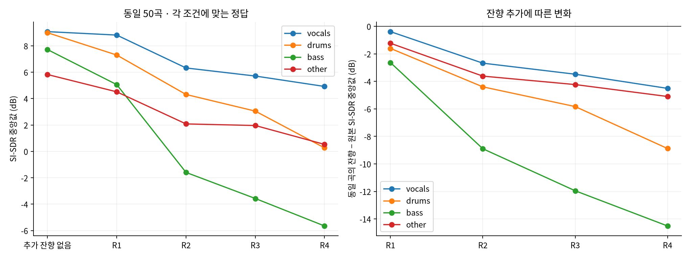
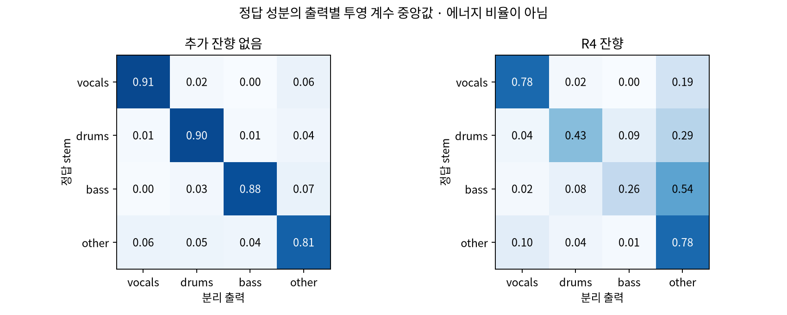
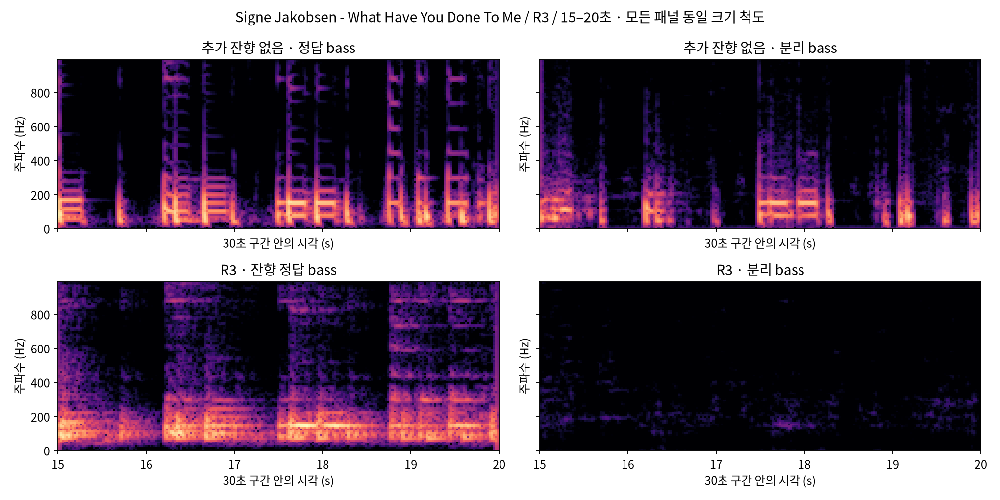
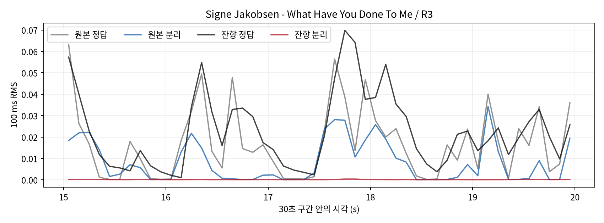
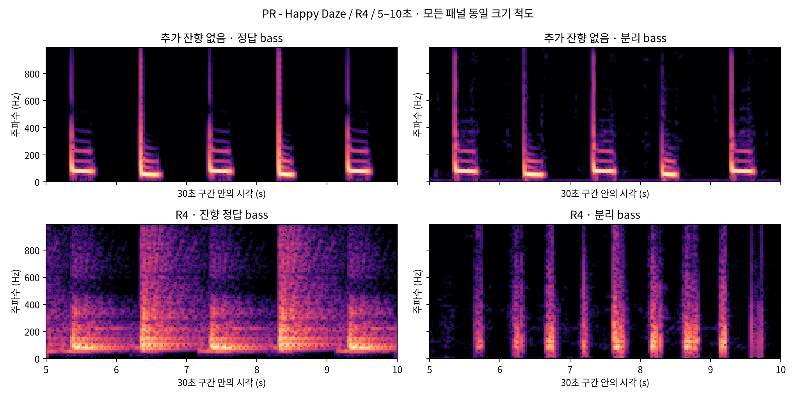
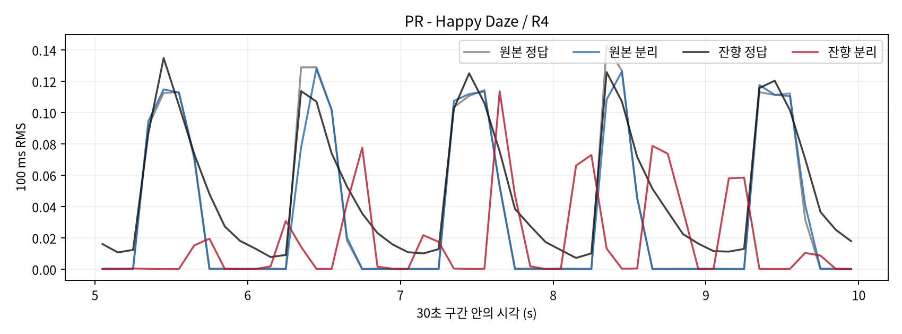

# 추가 잔향이 HTDemucs 분리에 미치는 영향

2026-11-10 실험 · 동일 곡·구간·분리기 설정의 대응 비교

이번에는 **추가 잔향 없는 50곡의 HTDemucs 분리를 새로 실행**했다. 같은 곡의 기존 gpuRIR R1~R4 혼합·정답·HTDemucs 출력 200개 조건을 읽어 비교했다. 다른 분리기나 후처리는 사용하지 않았다. 원 stem 자체에 제작 잔향이 있을 수 있어 첫 조건은 “추가 잔향 없음”으로 부른다.

## 먼저 확인된 문제

**추가 잔향에 따른 오류는 베이스·드럼의 목표 성분 손실과 other의 간섭 증가에 집중된다.** 원래 입력에 있던 bass stem의 전체 RMS는 잔향 합성 때 유지했는데, 분리 후 bass 출력의 목표 성분 보존은 크게 떨어졌다.

1. **베이스의 영향이 가장 크다.** 같은 50곡의 R4−원본 SI-SDR 차이 중앙값은 −14.51 dB다. 원본에서는 소실 판정이 0/50이었으나 R1/R2/R3/R4에서 3/9/15/14곡, 합계 41/200조건(18곡)에서 새 소실이 발생했다. 개발·평가 분할을 따로 봐도 R4 베이스 하락은 각각 −14.82/−14.41 dB로 같은 방향이다.
2. **베이스의 실패 유형이 두 가지다.** 41개 소실 조건 중 23개는 출력 RMS도 정답의 10% 미만이다. 나머지 18개는 그 이상의 출력이 남지만 정답 베이스와 일치하는 성분이 약하다. 모두 단순한 음량 감소로 처리해서는 안 된다.
3. **베이스와 일치하는 성분이 other에서 더 크게 나타난다.** 새 소실 41조건을 동일하게 짝지어 보면 bass 출력의 투영 계수 중앙값은 원본 0.778→잔향 0.012, other 출력은 0.126→0.727로 바뀐다. drums 출력도 0.062→0.155다. 오배정과 일치하는 관찰이지만 이 숫자를 에너지 이동 비율로 해석하지 않는다.
4. **드럼도 주요 대상이다.** R4−원본 SI-SDR 차이는 −8.88 dB, target gain 중앙값은 0.902→0.434다. 드럼의 저역 손실도 커서 낮은 주파수를 전부 bass로 옮기는 규칙은 적절한 출발점이 아니다.
5. **other는 누출 증가가 두드러진다.** target gain 중앙값은 0.812→0.781로 비교적 유지되는 반면, 대응 ΔSI-SIR은 −13.63 dB, ΔSI-SAR은 −0.76 dB다. 이 지표 정의에서는 자체 성분을 잃는 것보다 다른 성분이 섞이는 변화가 더 두드러진다.
6. **경계 구간만의 문제는 아니다.** 5초 구간별 베이스 하락 중앙값은 잔향 4조건을 합쳐 −8.08~−9.67 dB로, 중간 구간에서도 이어진다. R4의 베이스 대역별 하락은 20–80 Hz −15.01 dB, 80–250 Hz −13.98 dB이며 250–1000 Hz도 −11.84 dB다. 저역에 집중되지만 특정 한 대역으로만 제한되지는 않는다.
7. **정답이 달라진 영향만으로 설명되지는 않는다.** 같은 wet 정답에 대해 원본을 먼저 분리하고 동일 RIR을 붙인 대조군보다, 잔향 혼합을 분리한 출력의 SI-SDR이 R4에서 bass −12.22 dB, drums −7.87 dB 낮다. 잔향 입력을 분리하는 과정에서 추가 오류가 발생한다는 근거다.

네 분리 출력의 합은 혼합에 비교적 가깝다. 혼합 대비 합산 잔차 에너지의 중앙값은 원본 −29.94 dB, R4 −27.55 dB다. 따라서 합산 잔차만 고치는 방법으로 큰 음원별 오배정을 모두 설명하거나 해결하기는 어렵다.

**아직 확정하지 못한 것은 잔향의 어느 물리적 성분이 이 오류를 만드는가다.** 후기 꼬리, 초기 반사·주파수 착색, 음원별 전파 지연이 함께 들어갔다. 다음 원인 분리 실험은 동일 곡·배치에서 `지연만 → 직접음 뒤 초기 50 ms → 전체 RIR`을 비교하는 것이다. 이 추가 대조는 아직 실행하지 않았다. RT60 값만으로 보정 강도를 정하기 전에 이 구분을 확인하는 것이 적절하다.

## 1 무엇을 비교했나

| 조건 | 처리 순서 | 평가 정답 | 목적 |
|---|---|---|---|
| 원본 | 원 stem 합 → HTDemucs | 원 stem | 추가 잔향 전 분리 품질 |
| R1~R4 | 원 stem별 RIR 적용 → 합산 → HTDemucs | 같은 RIR을 적용한 stem | 잔향을 넣은 뒤 분리할 때의 변화 |
| 순서 대조 | 원 stem 합 → HTDemucs → 각 출력에 RIR 적용 | 위와 같은 wet stem | 같은 정답에서 분리 순서의 차이 확인 |

순서 대조에는 정확한 RIR과 데이터 생성에 사용한 stem별 이득을 사용했다. 출력 자체의 RMS로 다시 정규화하지 않았다. 이는 **원인 분석용 대조이며 실제 사용할 후처리 방법이 아니다.** 원본 분리의 누출도 해당 출력의 RIR로 처리되므로 단일 원인의 완전한 분해나 성능 상한으로 해석하지 않는다.

MUSDB18-HQ test 50곡 중앙 30초, 44.1 kHz stereo, HTDemucs 955717e8, FP32, shifts 0, segment 7초, overlap 0.25를 유지했다. R1~R4는 같은 방·배치에서 잔향 조건을 바꾼 합성 RIR이며, 측정 평균 T30 기반 T60 추정은 0.223/0.921/1.356/2.078초다. 네 개의 서로 다른 실제 방 실험이 아니다.

## 2 음원별 성능 변화

각 조건의 절대 SI-SDR 중앙값과 같은 곡의 R4−원본 차이 중앙값이다. **두 중앙값을 빼서 차이 중앙값을 대신하지 않았다.**

| 음원 | 원본 | R1 | R2 | R3 | R4 | 대응 R4−원본 | 차이의 95% CI |
|---|---:|---:|---:|---:|---:|---:|---|
| vocals | 9.08 | 8.82 | 6.32 | 5.71 | 4.92 | -4.51 | [-5.03, -3.99] |
| drums | 8.99 | 7.30 | 4.31 | 3.05 | 0.27 | -8.88 | [-10.14, -7.09] |
| bass | 7.72 | 5.06 | -1.59 | -3.57 | -5.65 | -14.51 | [-16.52, -12.23] |
| other | 5.83 | 4.51 | 2.08 | 1.96 | 0.53 | -5.10 | [-6.08, -4.64] |

단위는 dB다. CI는 같은 곡의 대응 차이를 곡 단위로 10,000회 재표집한 탐색적 구간이며, 여러 음원·조건을 살펴보는 이번 분석의 확증적 다중검정 판정은 아니다. 무음 정답 등 미정의 관측은 제외하고 CSV에 유효 수를 기록했다.

## 3 손실과 누출을 구분하기

| 음원 | 원본 target gain 중앙값 | R4 target gain 중앙값 | 대응 ΔSI-SIR | 대응 ΔSI-SAR |
|---|---:|---:|---:|---:|
| vocals | 0.911 | 0.779 | -6.49 | -4.23 |
| drums | 0.902 | 0.434 | -8.32 | -9.10 |
| bass | 0.883 | 0.261 | -17.27 | -8.94 |
| other | 0.812 | 0.781 | -13.63 | -0.76 |

target gain은 정답 파형 방향의 성분 계수다. SI-SIR은 정답 4개가 이루는 공간 안의 간섭, SI-SAR은 그 공간 밖의 오차를 평가한다. 서로 상관된 음악 stem과 지표 정의의 영향을 받으므로 하나의 지표만으로 청취상 원인을 확정하지 않는다.

## 4 베이스 소실이 언제 늘었나

소실은 기존 기준인 bass target gain <0.1이다. 이 기준은 완전한 무음 판정과 다르다. 각 조건은 동일한 50곡이다.

| 조건 | 소실 수 / 유효 곡 | 원본에서는 소실이 아니었으나 새로 소실 | 원본과 현재 모두 소실 |
|---|---:|---:|---:|
| 추가 잔향 없음 | 0/50 | — | — |
| R1 | 3/50 | 3 | 0 |
| R2 | 9/50 | 9 | 0 |
| R3 | 15/50 | 15 | 0 |
| R4 | 14/50 | 14 | 0 |

소실 판정은 파형의 일치 계수 기준이다. 실제 출력 크기도 따로 확인했다. 아래의 RMS 비율 0.1은 출력 진폭이 정답의 10% 미만인지 구분하는 추가 진단 기준이며, 기존 소실 정의를 변경하지 않는다.

| 조건 | 전체 bass 출력/정답 RMS 비율 중앙값 | 소실 사례 중 RMS도 0.1 미만 | 소실 사례의 RMS 비율 중앙값 | 음수 target gain 수 |
|---|---:|---:|---:|---:|
| original | 0.952 | 0/0 | 미정의 | 0 |
| R1 | 0.893 | 1/3 | 0.184 | 0 |
| R2 | 0.636 | 4/9 | 0.105 | 1 |
| R3 | 0.597 | 8/15 | 0.084 | 0 |
| R4 | 0.593 | 10/14 | 0.030 | 0 |

개발 10곡·평가 40곡을 합친 진단이다. 예전 31/160은 평가 40곡의 잔향 4조건만 센 수치이므로 이 표의 50곡별 수와 직접 혼합하지 않는다. 분할별 결과는 `분석요약.json`의 `by_split` 및 CSV에 따로 남겼다.

## 5 정답 성분은 어느 출력에서 나타나나

각 정답 stem과 각 분리 출력 사이의 투영 계수 중앙값이다. 행은 정답 음원, 열은 분리 출력이다. 대각선은 해당 음원 자신의 target gain이다. 비대각선 값은 음원 간 상관의 영향도 받는다. **에너지의 이동 비율이 아니며 행의 합이 1일 필요도 없다.**

| 정답 bass와의 투영 계수 | vocals 출력 | drums 출력 | bass 출력 | other 출력 |
|---|---:|---:|---:|---:|
| original | 0.005 | 0.027 | 0.883 | 0.068 |
| R4 | 0.018 | 0.076 | 0.261 | 0.543 |

## 6 주파수와 시간 구간

R4에서 원본 대비 주파수대별 SI-SDR 변화량 중앙값이다. 복소 STFT에 실수 scale 투영을 사용한 진단 지표이며, 전체 파형 SI-SDR과 같은 숫자로 취급하지 않는다. 양쪽 정답에서 대역 에너지가 전체의 0.01% 이상인 표본만 포함했다.

| 음원 | 20–80 Hz | 80–250 Hz | 250–1000 Hz | 1–4 kHz | 4–16 kHz |
|---|---:|---:|---:|---:|---:|
| vocals | -22.84 | -9.60 | -4.59 | -4.19 | -5.75 |
| drums | -12.10 | -8.41 | -7.33 | -5.80 | -4.08 |
| bass | -15.01 | -13.98 | -11.84 | -5.92 | -0.02 |
| other | -9.12 | -6.72 | -3.75 | -3.25 | -5.35 |

5초 구간별 표는 전체 30초 안의 어느 구간에서 차이가 커지는지 보여준다. 각 열의 값은 50곡×4조건에서 해당 시간대의 대응 차이를 집계한 값이다.

| 음원 | 0–5 s | 5–10 s | 10–15 s | 15–20 s | 20–25 s | 25–30 s |
|---|---:|---:|---:|---:|---:|---:|---:|
| vocals | -2.50 | -2.92 | -3.03 | -2.65 | -3.77 | -3.02 |
| drums | -4.98 | -4.57 | -4.82 | -4.56 | -4.53 | -4.79 |
| bass | -8.42 | -8.79 | -8.08 | -8.36 | -9.67 | -9.44 |
| other | -3.15 | -3.61 | -3.34 | -3.57 | -4.21 | -3.33 |

## 7 같은 wet 정답에서 분리 순서 비교

다음 값은 “잔향 입력 분리 − 원본 분리 후 RIR 적용”의 SI-SDR 차이 중앙값이다. 음수이면 잔향 입력을 직접 분리한 결과가 더 나쁘다.

| 음원 | R1 | R2 | R3 | R4 |
|---|---:|---:|---:|---:|
| vocals | -0.40 | -2.96 | -3.78 | -4.84 |
| drums | -0.95 | -3.41 | -4.25 | -7.87 |
| bass | -2.15 | -6.76 | -9.47 | -12.22 |
| other | -1.40 | -3.83 | -4.52 | -5.70 |

이 대조는 원본과 wet 정답이 다르기 때문에 생기는 해석 문제를 줄인다. 잔향에 의한 색채 변화, 초기 반사, 후기 잔향, 분리기의 비선형 반응을 각각 독립적으로 식별한 것은 아니다.

## 8 대표 악화 구간

원본 bass gain ≥0.3, 잔향 bass gain <0.1인 5초 구간에서 두 유형을 나눠 그린다. 첫 유형은 출력 RMS가 정답의 10% 미만인 실제 약화, 둘째는 출력 RMS가 10% 이상인데 정답 성분이 매우 약한 불일치다. 각 유형에서 SI-SDR 하락이 가장 큰 구간을 선택했다. 전체 경향을 대표한다고 가정하지 않으며 실제 청취 결과도 아니다.

실제 출력 약화 사례: **Signe Jakobsen - What Have You Done To Me / R3 / crop 15–20초**. SI-SDR -0.65→-70.22 dB, 잔향 출력/정답 RMS 비율 0.0060.

출력 음량이 남아 있지만 정답과 일치하지 않는 별도 사례:

출력과 정답의 불일치 사례: **PR - Happy Daze / R4 / crop 5–10초**. SI-SDR 12.48→-80.04 dB, 잔향 출력/정답 RMS 비율 0.5134.

| 곡 | 조건 | 30초 구간 내 시작 | 원본 SI-SDR | 잔향 SI-SDR | 차이 |
|---|---|---:|---:|---:|---:|
| PR - Happy Daze | R4 | 5 s | 12.48 | -80.04 | -92.52 |
| PR - Happy Daze | R4 | 25 s | 13.36 | -72.66 | -86.03 |
| Signe Jakobsen - What Have You Done To Me | R3 | 15 s | -0.65 | -70.22 | -69.56 |
| Georgia Wonder - Siren | R3 | 20 s | 9.66 | -50.21 | -59.87 |
| Tom McKenzie - Directions | R1 | 25 s | 1.90 | -56.50 | -58.41 |
| PR - Happy Daze | R3 | 25 s | 13.36 | -41.62 | -54.98 |

## 9 확인 범위와 해석 한계

- 이번 분석은 사용자가 요청한 별도 사후 진단이다. 기존 평가 40곡의 결과와 정답을 추가로 살폈으므로 향후 새 방법을 설계할 때 이 자료를 다시 미관측 평가 세트로 주장하지 않는다.
- R1~R4는 T60뿐 아니라 RIR의 반사·주파수 응답·직접음 대비 잔향 관계가 함께 달라질 수 있다. 현재 결과만으로 “T60 하나가 원인”이라고 단정하지 않는다.
- 같은 mono RIR을 L/R에 적용했다. 새로운 마이크 간 공간 차이의 효과는 이 실험에서 시험하지 않았다.
- 30초 crop 후 convolution·꼬리 절단·stem별 RMS 복원이라는 기존 합성 절차를 유지했다. 실제 공간의 거리 감쇠와 장시간 경계 조건을 그대로 재현하는 설정은 아니다.
- 높은 지표가 청취 품질을 보장하지 않으며, 정답 stem의 기존 제작 잔향과 라벨 오류도 남아 있다.
- 후처리 후보, 모델 평균 비율, RT60 조건화는 이번에 선택하거나 시험하지 않았다. 우선 잔향으로 생기는 오류 위치와 유형을 측정했다.

## 10 검증과 산출물

기존 wet 결과와 3824개 수치 대조: 최대 절대 차이 4.26e-11. 표본의 기존 projection 함수와 새 공통 계산 경로 최대 차이는 1.86e-11 dB. wet 정답 재합성 최대 오차는 0다.

지표 계산은 조건이 안정적인 4×4 Gram 해법을 사용하고 불안정할 때 기존 SVD 방식으로 돌아간다. 첫 표본의 두 방식 180개 수치 대조도 별도로 통과했다. 전체 새 wet 점수는 기존 저장 점수와 다시 대조했다.

- `조건별_음원별_성능.csv`: 개발/평가/전체, 조건·음원별 중앙값과 유효 수.
- `원본대비_곡별_변화.csv`: 같은 곡·음원의 차이와 순서 대조.
- `5초구간별_변화.csv`: 실패 구간과 원곡상의 시각.
- `주파수대별_변화.csv`: 대역별 오차와 유효 여부.
- `분석요약.json`: 모든 집계·신뢰구간·소실 전이·검증 수치.
- 분석 코드·원자료 기록: 문서 프로젝트 `.agent_reports/2026-11-10_dry_wet_diagnostic/`.
- 새 원본 분리 cache: `/home/iiplab/code/music-source-separation/.agent_runtime/dry-wet-diagnostic-20261110/`.
- 기존 코드·RIR·모델·wet 결과는 변경하지 않았다.

측정 비용: 원본 50곡 출력 준비 약 95초(첫 표본 cache 재사용 포함), 최종 CPU 상세 분석 약 10분 32초. 구현·pilot·속도 개선을 위한 초기 CPU 실행 중단·집계·문서 작성 시간은 별도다. GPU 오류 확인은 통과했다.
